# 🏛️ MCET Seminar Hall Booking System

A College ERP module for **Dr. Mahalingam College of Engineering and Technology (MCET), Pollachi** that lets faculty book seminar halls online, with automatic clash detection and a three-level approval workflow.

🌐 **Live:** https://booking.dexoshpuse.com

| | |
| :--- | :--- |
| **Backend** | Python Django (modular apps) |
| **Frontend** | HTML5, CSS3, Vanilla JS, Outlook-style calendar |
| **Database** | MySQL (production) / SQLite (development) |
| **Login** | Microsoft Entra ID (Outlook) OAuth 2.0 + demo login for dev |
| **Hosting** | MilesWeb cPanel, Python App (Phusion Passenger) |
| **Theme** | Navy `#123B72` · Royal Blue `#1D5FA7` · Light Blue `#EAF3FF` |

---

## 📑 Table of Contents

1. [How it works (big picture)](#1-how-it-works-big-picture)
2. [Project structure](#2-project-structure)
3. [User roles](#3-user-roles)
4. [Login flow](#4-login-flow)
5. [Booking flow and availability engine](#5-booking-flow-and-availability-engine)
6. [Approval workflow](#6-approval-workflow)
7. [Database model](#7-database-model)
8. [Local setup](#8-local-setup)
9. [Deployment on MilesWeb cPanel](#9-deployment-on-milesweb-cpanel)

---

## 1. How it works (big picture)

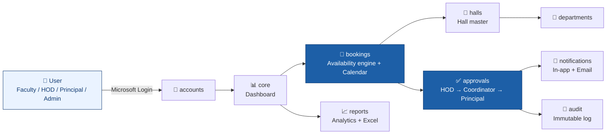

**In one line:** a user logs in with their college Outlook account, picks a hall and time, the system checks for clashes, and the request travels through HOD, Hall Coordinator and Principal before it is confirmed on the calendar.

---

## 2. Project structure

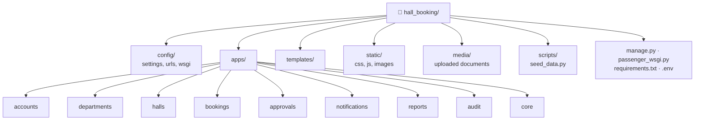

| App | What it does |
| :--- | :--- |
| `accounts` | User profiles, Microsoft OAuth, role-based access, demo login |
| `departments` | Department master data |
| `halls` | Seminar hall master, capacity, facilities, maintenance |
| `bookings` | Availability engine, reservations, Outlook-style calendar |
| `approvals` | Multi-level approval workflow |
| `notifications` | In-app notifications and email alerts |
| `reports` | Analytics dashboard and Excel (.xlsx) export |
| `audit` | Immutable audit trail |
| `core` | System settings, context processors, dashboard |

<details>
<summary>📂 Full folder tree</summary>

```
hall_booking/
├── manage.py
├── passenger_wsgi.py          # MilesWeb Passenger entry point
├── requirements.txt
├── .env.example
├── config/                    # settings, urls, wsgi
├── apps/
│   ├── accounts/  departments/  halls/  bookings/
│   ├── approvals/ notifications/ reports/ audit/ core/
├── templates/                 # base, authentication, dashboard, bookings,
│                              # calendar, halls, departments, accounts,
│                              # reports, notifications, audit, settings
├── static/                    # css, js, images
├── media/                     # uploaded schedules & approval docs
└── scripts/seed_data.py
```
</details>

---

## 3. User roles

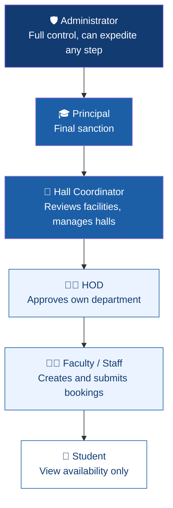

### Permission matrix

| Role | View availability | Create bookings | HOD approval | Coordinator review | Principal approval | Hall master | Audit logs and settings |
| :--- | :---: | :---: | :---: | :---: | :---: | :---: | :---: |
| **Student** | ✅ | ❌ | ❌ | ❌ | ❌ | ❌ | ❌ |
| **Faculty / Staff** | ✅ | ✅ | ❌ | ❌ | ❌ | ❌ | ❌ |
| **HOD** | ✅ | ✅ | ✅ own dept | ❌ | ❌ | ❌ | ❌ |
| **Hall Coordinator** | ✅ | ✅ | ❌ | ✅ all halls | ❌ | ✅ full | ❌ |
| **Principal** | ✅ | ✅ | ❌ | ❌ | ✅ final | 👁️ view | 👁️ view |
| **Administrator** | ✅ | ✅ | ⚡ expedite | ⚡ expedite | ⚡ expedite | ✅ | ✅ full |

---

## 4. Login flow

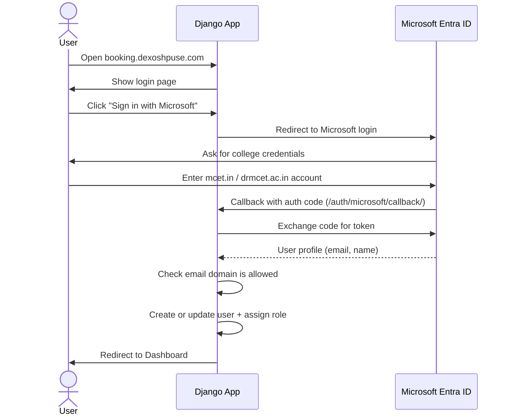

> 🧪 **Demo mode:** when `ENABLE_DEMO_LOGIN=True` (development only), the login page shows one-click role accounts. **Always set it to `False` in production.**

---

## 5. Booking flow and availability engine

Every booking request goes through these checks **before** it is saved.

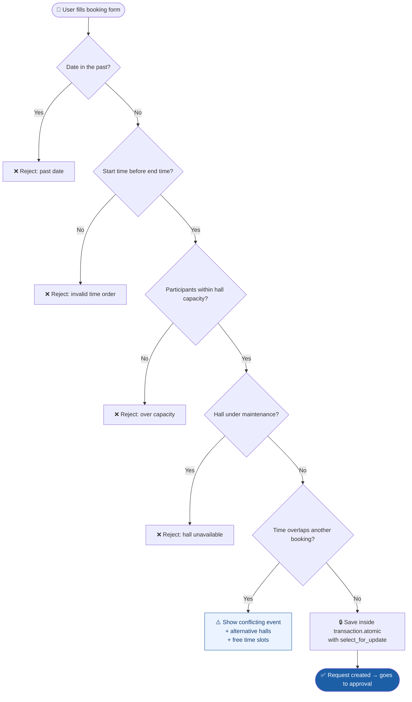

**Clash rule:**

```
new.start_time < existing.end_time  AND  new.end_time > existing.start_time
```

**Concurrency protection:** two people booking the same slot at the same moment cannot both succeed, because the database row is locked during the save (`select_for_update()`).

---

## 6. Approval workflow

### Step by step

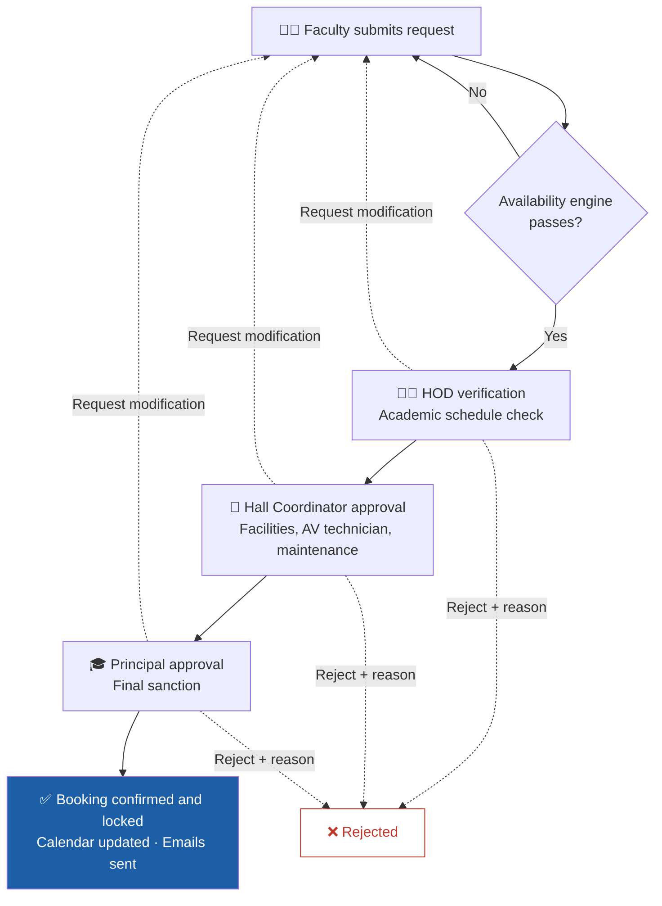

### Booking status lifecycle

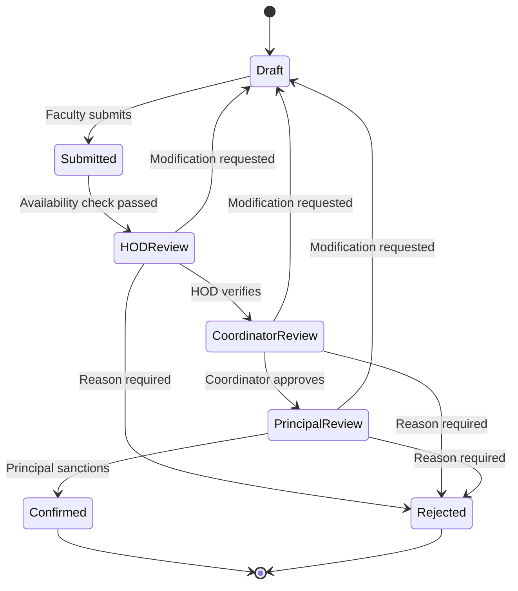

**Rules**
- A rejection **must** include a written reason, which is stored in the immutable audit trail.
- "Request Modification" sends the booking back to **Draft** so the faculty can edit and resubmit.
- Administrators can expedite any step.

### Who gets notified

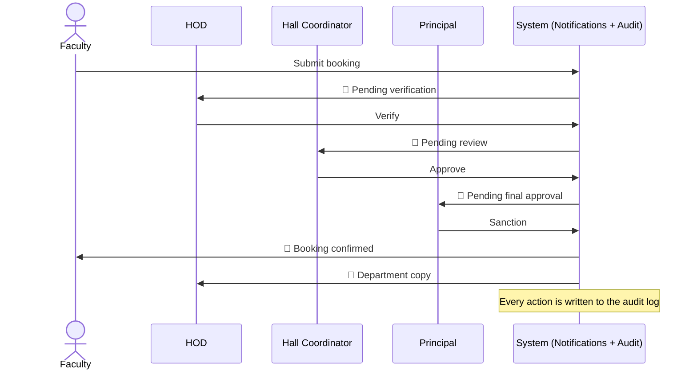

---

## 7. Database model

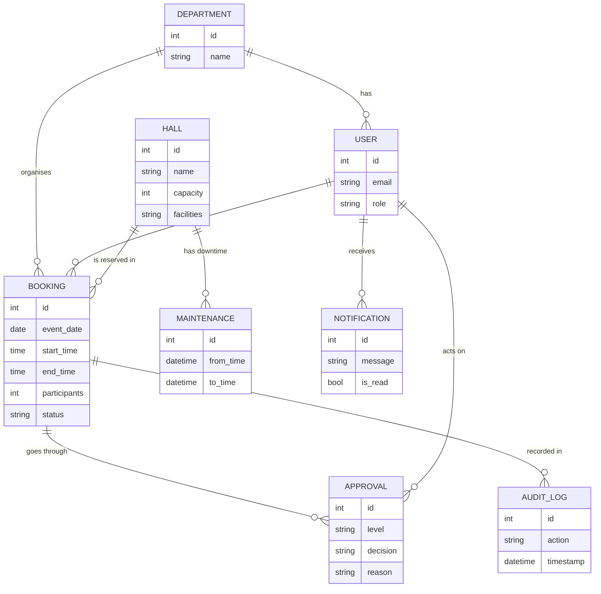

> ℹ️ Simplified view. Field names are illustrative; see each app's `models.py` for the exact schema.

---

## 8. Local setup

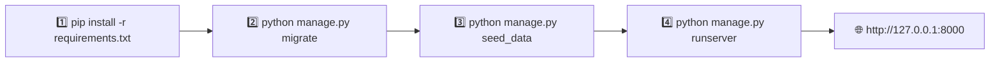

```powershell
pip install -r requirements.txt
python manage.py migrate
python manage.py seed_data      # 10 departments, 5 halls, 7 sample users, 20 bookings
python manage.py runserver 127.0.0.1:8000
```

Open http://127.0.0.1:8000 and pick a demo account.

### Demo accounts (development only)

Set `ENABLE_DEMO_LOGIN=True` in `.env`. Passwords are defined in the seed data, not in this README.

| Role | Email |
| :--- | :--- |
| System Administrator | `admin@mcet.in` |
| Principal | `principal@mcet.in` |
| Hall Coordinator | `coordinator@mcet.in` |
| HOD (IT) | `hod.it@mcet.in` |
| Faculty Coordinator | `faculty.it@mcet.in` |
| Student Representative | `727624P80@mcet.in` |

---

## 9. Deployment on MilesWeb cPanel

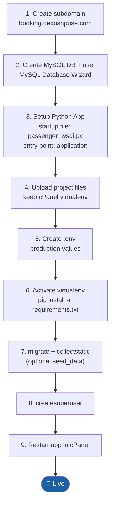

### Microsoft Entra ID setup

1. Open the [Microsoft Entra Admin Center](https://entra.microsoft.com/) and register an application.
2. Add a **Web** platform with redirect URI `https://booking.dexoshpuse.com/auth/microsoft/callback/`.
3. Create a client secret, then copy the Client ID and Tenant ID.

### Production `.env`

```ini
SECRET_KEY=generate-a-strong-random-50-character-secret-key
DEBUG=False
ALLOWED_HOSTS=booking.dexoshpuse.com,localhost,127.0.0.1
CSRF_TRUSTED_ORIGINS=https://booking.dexoshpuse.com

# Database
DB_ENGINE=mysql
DB_NAME=username_mcethall
DB_USER=username_mcetusr
DB_PASSWORD=your_secure_mysql_password
DB_HOST=localhost
DB_PORT=3306

# Microsoft Entra ID
MICROSOFT_CLIENT_ID=your-microsoft-client-id
MICROSOFT_CLIENT_SECRET=your-microsoft-client-secret
MICROSOFT_TENANT_ID=common
MICROSOFT_REDIRECT_URI=https://booking.dexoshpuse.com/auth/microsoft/callback/
ALLOWED_EMAIL_DOMAINS=mcet.in,drmcet.ac.in

# Security
ENABLE_DEMO_LOGIN=False

# Email (SMTP)
EMAIL_BACKEND=django.core.mail.backends.smtp.EmailBackend
EMAIL_HOST=mail.booking.dexoshpuse.com
EMAIL_PORT=587
EMAIL_USE_TLS=True
EMAIL_HOST_USER=notifications@booking.dexoshpuse.com
EMAIL_HOST_PASSWORD=your-email-account-password
DEFAULT_FROM_EMAIL=MCET College ERP <notifications@booking.dexoshpuse.com>
```

### Commands (virtualenv active)

```bash
cd /home/username/booking.dexoshpuse.com
pip install --upgrade pip
pip install -r requirements.txt
python manage.py migrate
python manage.py collectstatic --noinput
python manage.py seed_data          # optional
python manage.py createsuperuser    # if not seeded
```

Then click **Restart** in cPanel → **Setup Python App**.

---

<p align="center">Built for Dr. Mahalingam College of Engineering and Technology, Pollachi</p>
